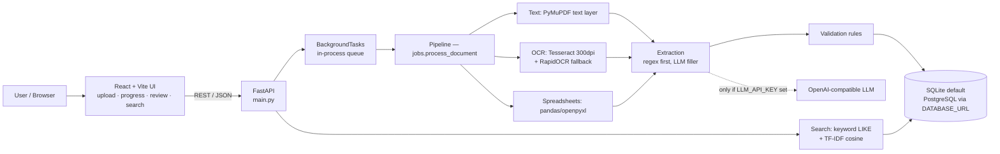
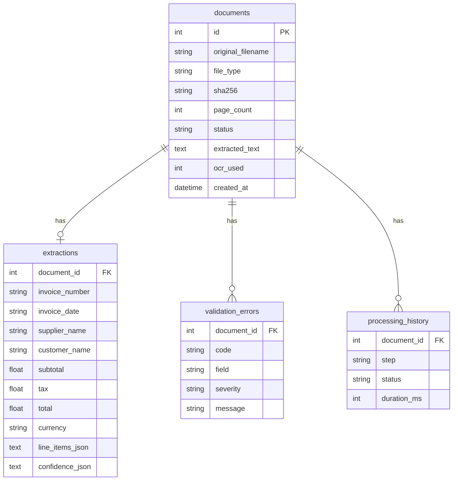

# Architecture

## System diagram

## Request flow (one upload)

1. `POST /documents/upload` — files validated (type, ≤50 MB), stored by SHA-256, one `documents` row each with status `queued`, 202 returned immediately.
2. Background job `process_document` runs: text/OCR/spreadsheet parse → extraction → validation → `done` / `needs_review` / `failed`. Every step is written to `processing_history` with timing.
3. `GET /documents/{id}/status` polls progress; the UI polls every 3 s.
4. Correction (`PATCH …/correct`) re-runs validation and updates status. Failed jobs can be re-queued (`POST …/reprocess`) without re-uploading.

## Database schema

## Scaling (what changes at 1,000 pages/day and beyond)

- **Queue:** replace `BackgroundTasks` with Celery/RQ on Redis (`REDIS_URL`); `process_document()` is already the worker body, no pipeline rewrite.
- **OCR:** Tesseract is CPU-bound (~1–3 s/page at 300 dpi). Scale workers horizontally; cache OCR text by file SHA-256 so re-uploads skip OCR.
- **Search:** TF-IDF is rebuilt per query over the corpus — fine for thousands of docs, not millions. At that scale move to pgvector or Chroma with an embedding model; `search.py` is the only module that changes.
- **Storage:** move uploads from local disk to S3-compatible object storage; store only the object key in `documents.filename`.
- **DB:** SQLite → PostgreSQL (`DATABASE_URL`); add indexes already present on `status`, `invoice_number`, `supplier_name`.

## Failure handling

| Failure | Behaviour |
|---|---|
| Corrupt PDF / unreadable spreadsheet | `failed`, human-readable `error_message`, original kept for reprocess |
| Scanned doc, no OCR engine installed | `failed` naming the missing binary (Tesseract) instead of silent garbage |
| LLM unreachable / no key | Skipped silently; deterministic extraction still runs |
| Total mismatch / missing field / duplicate | `needs_review` + validation errors, never silently accepted |
| Duplicate upload (same SHA-256) | Stored once on disk; each upload still gets its own document row + duplicate-invoice flag if the invoice number repeats |

## Security

- Uploads: extension allow-list, 50 MB cap, stored under a hash name (no path traversal via filename), never executed.
- No secrets in code; LLM key via env only. CORS is wide open (`*`) for the demo — restrict to the frontend origin in production.
- **Not yet in this build (stated honestly):** authentication (add JWT/OAuth2), HTTPS termination, per-user document isolation, rate limiting, virus scanning of uploads. All are one-layer additions, listed here so the gap is explicit rather than hidden.
